# SYNCORA
### Plan. Coordinate. Deliver.
**Project Resource Allocation & Scheduling System**

[](https://tipoponi.github.io/syncora/)

> 🚀 **Live Interactive Testing Link**: **[https://tipoponi.github.io/syncora/](https://tipoponi.github.io/syncora/)**  
> *Test CPM scheduling, Gantt chart timeline, resource conflict detection, deliverables workflows, and executive analytics directly in your browser with zero installation required! Quick-fill demo credentials (Admin, Project Manager, Worker, Client, Vendor) are pre-loaded on the sign-in screen.*

[](https://openjdk.org/projects/jdk/21/)
[](https://spring.io/projects/spring-boot)
[](https://react.dev/)
[](https://www.typescriptlang.org/)
[](https://www.postgresql.org/)
[](https://fastapi.tiangolo.com/)
[](https://scikit-learn.org/)
[](LICENSE)
[](docs/INTEGRATION_TESTING.md)
[](docs/RELEASE_CHECKLIST.md)

> **A deterministic full-stack operations, workflow automation, business intelligence, multi-organization SaaS workspace, budget, procurement, deliverables approval, external integrations, organization-managed authentication, and scheduling platform for coordinating multi-project dependencies, resource allocations, Critical Path Method (CPM) analytics, downstream delay propagation, bounded multi-objective optimization, historical outcome analytics, ML-governed delay risk estimation, executive portfolio KPI dashboards, project cost variance management, and secure third-party interoperability.**

---

## 1. Problem Statement

Modern engineering, consulting, and manufacturing teams struggle with the cascading complexity of project coordination:
- **Hidden Resource Bottlenecks**: Team members are frequently double-booked across concurrent projects without automated cross-project overlap detection.
- **Cascading Delay Blindspots**: When a critical supplier delivery slips, managers cannot predict which downstream milestones or final client delivery dates are jeopardized.
- **Unverified Rescheduling Guesses**: Reallocating tasks manually often creates circular dependencies, over-allocates other team members, or breaches client contractual deadlines.
- **Unreliable LLM Guesswork & Fake ML**: Generic AI chat tools hallucinate calendar dates, and unvalidated ML models invent speculative delay probabilities without sufficient historical evidence.
- **Executive Portfolio Fragmentation**: Executives and PMs lack a unified portfolio view comparing baseline commitments against live forecasts, actual resource utilization, and vendor reliability across multiple simultaneous projects.
- **Multi-Tenant Isolation & SaaS Workspace Boundaries**: Organizations require isolated environments ensuring one client or tenant never accesses, modifies, or optimizes another organization's projects or proprietary resource rosters.
- **Procurement, Delivery Slippage & Uncontrolled Cost Creep**: Projects routinely exceed budgets when commitments made on purchase orders and vendor quotes are not tracked against approved baseline budgets and actual expenses.
- **Fragmented Identity & Account Sprawl**: Organizations need centralized governance over employee identifiers, invitation lifecycles, role-scoped permissions, and password security without risking cross-tenant credential leakage.

---

## 2. Proposed Solution

**SYNCORA** solves these operational bottlenecks by combining rigorous graph theory and deterministic discrete optimization with an intuitive SaaS interface, a secure AI intelligence layer, ethical ML forecasting, executive portfolio business intelligence, end-to-end budget & procurement management, and organization-managed authentication:
1. **Mathematical Scheduling Authority**: Implements topological sorting (Kahn's algorithm) and the Critical Path Method (CPM) to calculate early/late dates and task float across working-day calendars.
2. **Automated Resource Conflict Detection**: Continuously checks worker and equipment assignments for temporal overlaps across all active projects.
3. **Downstream Delay Ripple Propagation**: Propagates reported vendor and task delays through the dependency DAG, comparing forecasted completion against frozen baseline commitments.
4. **Heuristic Multi-Objective Optimizer**: Evaluates bounded alternative assignments and schedules, scoring candidates across deadline adherence, disruption minimization, and capacity balance.
5. **Human-in-the-Loop Governance**: Algorithmic recommendations must be explicitly reviewed and approved by project managers before being applied transactionally.
6. **Isolated AI Intelligence**: A dedicated FastAPI Python service generates contextual managerial explanations and what-if simulations using grounded project snapshots, while keeping scheduling logic 100% deterministic.
7. **Historical Analytics & Governed ML Risk (Phase 9)**: Tracks verified task outcomes, schedule variance, on-time delivery rates, and vendor delay causes. Incorporates a reproducible Scikit-Learn training pipeline with a strict $\ge 100$ completed sample gate to ensure models are never deployed on speculative or fabricated data.
8. **Portfolio Analytics & Executive KPI Dashboard (Phase 11)**: Aggregates enterprise-level performance metrics (Total/Active/Completed projects, Forecast Missed, On-Time Delivery Rate %, Average Variance Days, Resource Utilization %, Vendor Reliability Rate %) with mathematical safeguards against zero-denominator division.
9. **Multi-Organization Workspaces & SaaS Architecture (Phase 12)**: Implements shared-database, shared-schema multi-tenancy partitioned via `organization_id` foreign keys, backend-verified `TenantFilter` context lifecycle, workspace switching, organization-scoped RBAC, and suspended tenant locking gates.
10. **Budget, Procurement & Cost Management (Phase 13)**: Manages project baseline budgets, immutable approved revision history, vendor quotations with line-item pricing, purchase order lifecycle (`DRAFT` $\to$ `APPROVED` $\to$ `PARTIALLY_DELIVERED` $\to$ `DELIVERED`), delivery challan tracking, expense recording by cost category, and real-time cost variance analysis.
11. **Deliverables, Document Management & Approval Workflows (Phase 14)**: Structured deliverables with formal lifecycles (`PLANNED` $\to$ `IN_PROGRESS` $\to$ `SUBMITTED` $\to$ `UNDER_REVIEW` $\to$ `APPROVED`), versioned document file storage outside web root with SHA-256 integrity, review decisions with anti-self-approval enforcement, mandatory task completion gates, Critical Path delay impact analysis, and dedicated Client Review Portal.
12. **External Integrations & Interoperability (Phase 15)**: One-way calendar synchronization with Google Calendar and Microsoft Outlook, SSRF-protected outbound webhook subscriptions with HMAC-SHA256 payload signing, and scoped API key generation (`prs_live_...`) with SHA-256 database hashing.
13. **Release Candidate Stabilization & Mathematical Validation (Phase 16)**: Comprehensive regression testing suite verifying 119 automated tests, complete multi-module business workflows, and deterministic scheduling correctness across sequential, parallel, delay, conflict, and float scenarios.
14. **Organization-Managed Authentication & Employee Account Provisioning (Phase 18)**: Controlled multi-tenant organization onboarding (`/api/auth/register-organization`), atomic backend employee ID generation (`{ORG_CODE}-EMP-%04d`), multi-identity login (username, work email, or employee ID), cryptographically secure single-use invitation activation tokens, token-based self-service password reset, brute-force login throttling (15-min lockout after 5 consecutive failures), role-based demotion guards, and production-ready login with gated demo accounts.
15. **Authentication, Uniqueness & Account Management Corrections (Phase 19)**: Global case-insensitive username uniqueness across organizations with Flyway PostgreSQL migration (`LOWER(username)` unique index), unified 12–128 character password policy and strength meter, end-to-end tokenized password recovery flow (`/reset-password?token=...`) with automated token pre-verification, SHA-256 protected token hashing, atomic single-use invalidation, dev-mode direct recovery links without manual token copy-pasting, and verified seed development accounts across all supported roles.

---

## 3. Visual Gallery & Actual Running Interface

| Modern Executive Sign-In (Phase 17) | Operational SaaS Dashboard (Phase 17 Refined) |
|:---:|:---:|
| 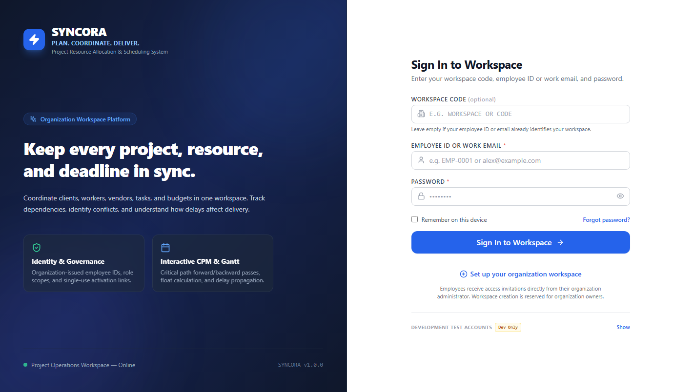 | 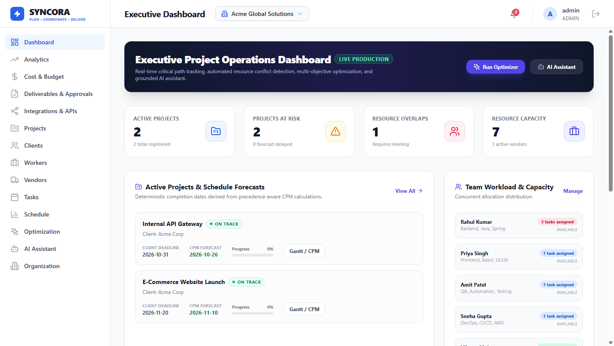 |
| *Enterprise sign-in portal: feature showcase, demo credential quick-fill, and modern security posture.* | *Real-time metrics: Projects at risk, active conflicts, upcoming milestones, and resource workload.* |

| Projects Management Ledger (Phase 17) | Workforce & Skills Roster (Phase 17) |
|:---:|:---:|
| 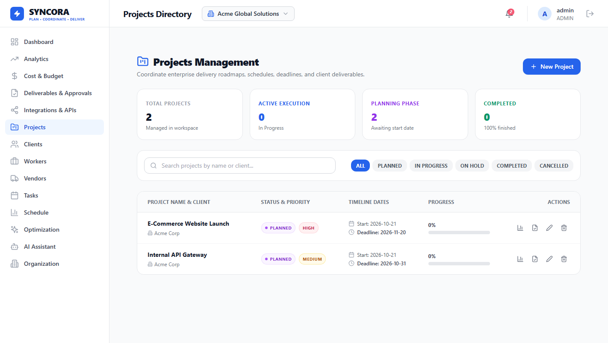 | 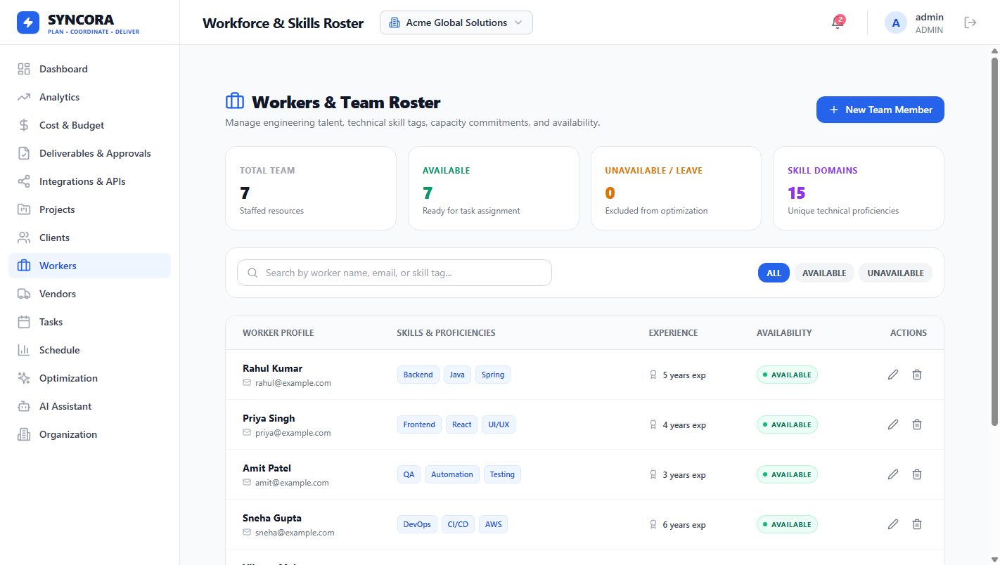 |
| *Complete project lifecycle, status filter pills, search bar, CRUD modal forms, and Gantt deep-links.* | *Team roster, technical skills tags, 1-click availability toggling, and concurrent task indicators.* |

| Client Partner Directory (Phase 17) | Tasks Planning & Execution Ledger (Phase 17) |
|:---:|:---:|
| 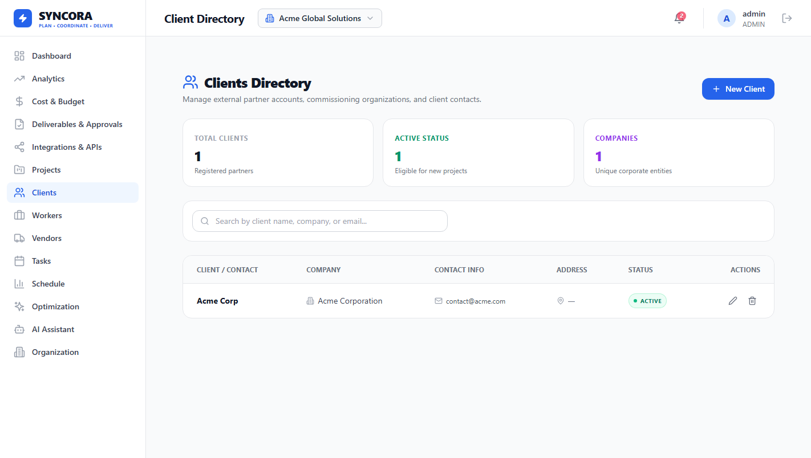 | 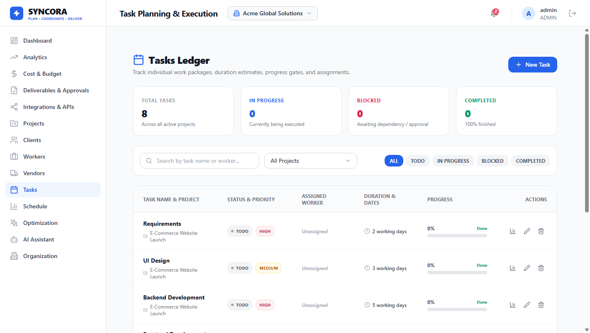 |
| *Client account management, corporate metadata, contact details, and project association counters.* | *Task work breakdown ledger, project filter dropdown, status & priority badges, and duration estimates.* |

| Deliverables & Approval Workflows (Phase 14) | Project Budget & Cost Variance (Phase 13) |
|:---:|:---:|
| 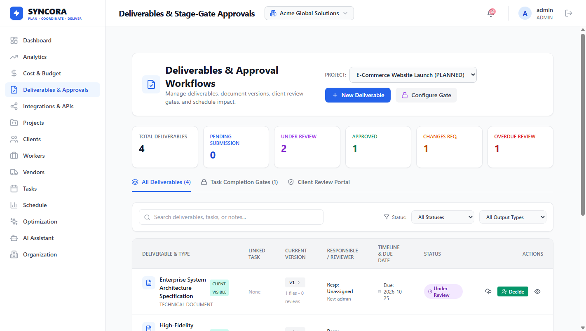 | 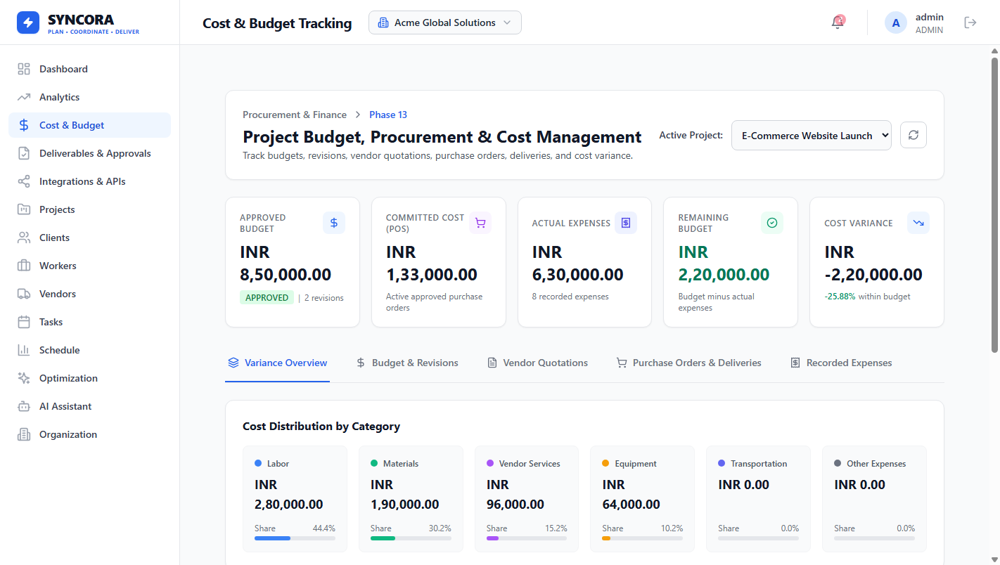 |
| *Deliverable management, versioned documents, approval decisions, task completion gates, and delay impact.* | *Budget overview, committed PO costs, actual expenses, cost variance %, and category distribution.* |

| Executive Portfolio Analytics (Phase 11) | Multi-Organization Workspaces (Phase 12) |
|:---:|:---:|
| 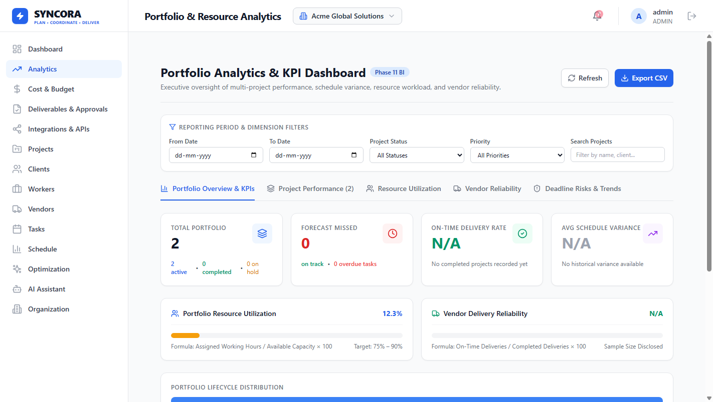 | 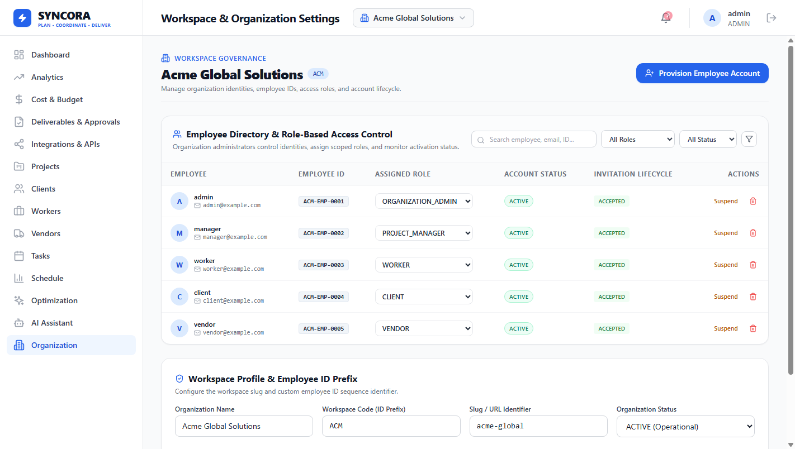 |
| *Executive KPI dashboard: Lifecycle distribution, forecast misses, historical variance, and vendor reliability.* | *Shared-schema multi-tenancy, workspace switcher, and organization member RBAC.* |

| Grounded AI Assistant & What-If Simulation | Interactive Gantt Timeline |
|:---:|:---:|
| 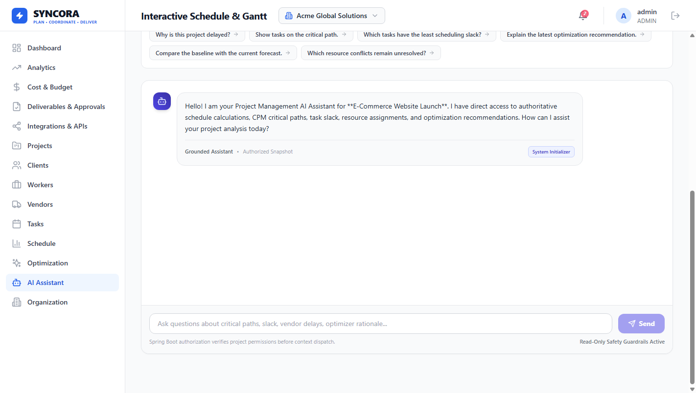 | 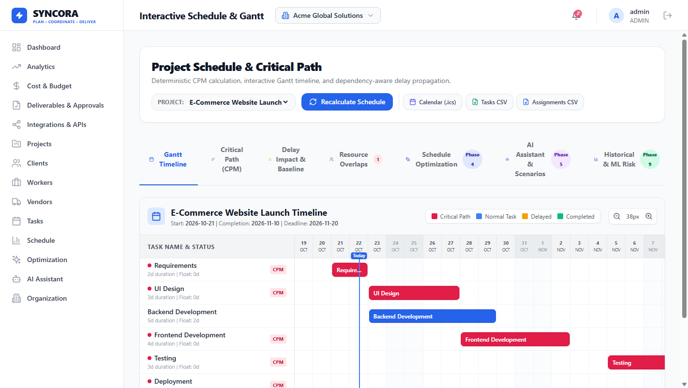 |
| *Natural-language explanations and in-memory hypothetical delay impact simulations.* | *Visual timeline with task dependencies, critical path highlights, and milestone markers.* |

| Critical Path Method (CPM) | Resource Conflict Detection |
|:---:|:---:|
| 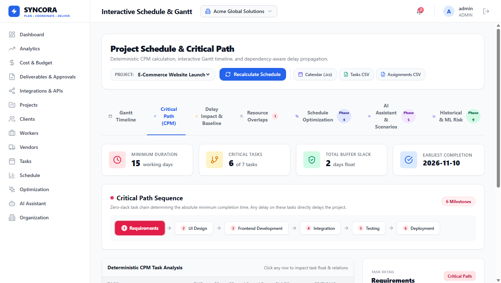 | 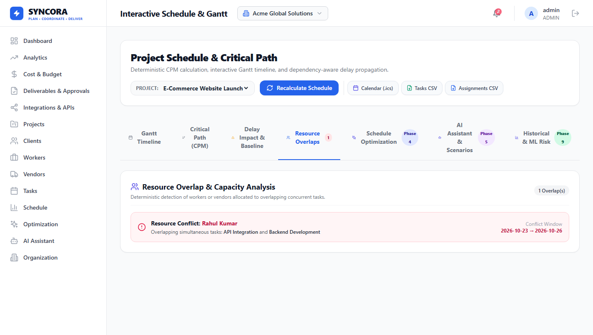 |
| *Forward/backward pass calculation showing Early/Late dates, total float, and identified bottlenecks.* | *Temporal collision analysis showing exact dates and tasks where workers are double-booked.* |

| Multi-Objective Schedule Optimization | External Integrations & Webhooks (Phase 15) |
|:---:|:---:|
| 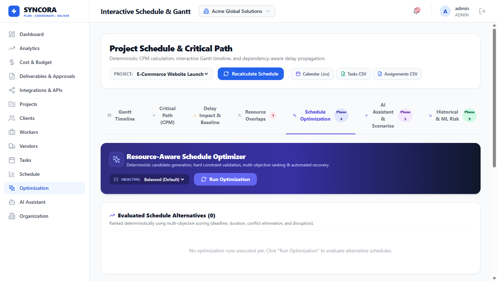 | 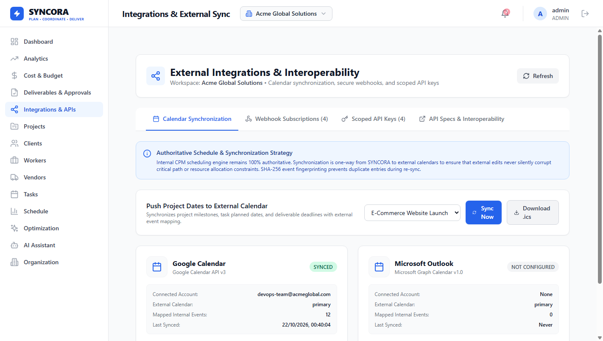 |
| *Ranked candidate alternatives with multi-metric scoring and human-in-the-loop approval.* | *Calendar synchronization (Google/Outlook), SSRF-protected webhooks, and scoped API keys.* |

| Vendor Directory & Validated CSV Import (Phase 10/17) | Historical Analytics & Delay Risk (Phase 9) |
|:---:|:---:|
| 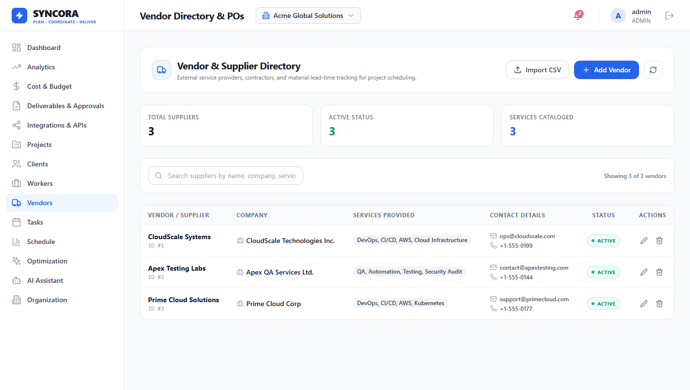 | 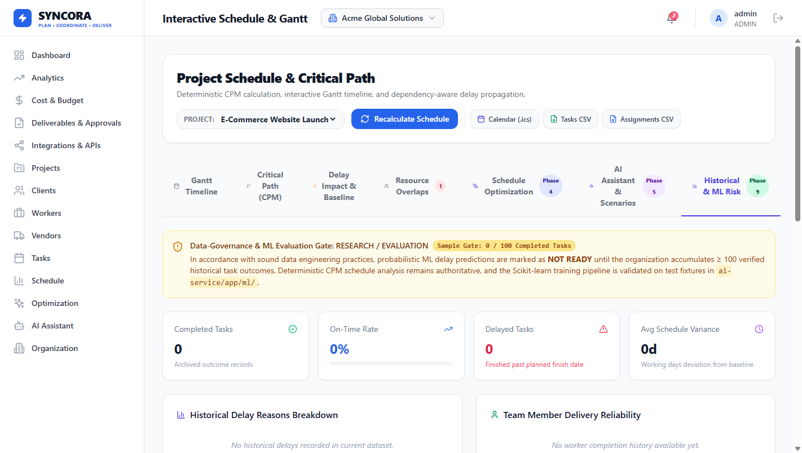 |
| *Active supplier roster, manual CRUD modals, and two-phase atomic CSV import modal.* | *Verified completion outcomes, schedule variance distributions, and ethical ML gating.* |

---

## 4. Key Implemented Features

- **Multi-Project & Resource Management**: Complete relational modeling of Clients, Projects, Tasks, Workers, Vendors, and Resources.
- **Dependency-Aware Scheduling Engine**: Directed Acyclic Graph (DAG) construction with cycle detection and working-day calendar logic (skipping weekends).
- **Critical Path Method (CPM)**: Forward and backward passes calculating Earliest Start/Finish, Latest Start/Finish, total float (slack), and zero-slack bottleneck tasks.
- **Approved Schedule Baselines**: Historical snapshots (`project_baselines`, `task_baselines`) for precise variance tracking against approved plans.
- **Delay Propagation**: Automated topological ripple propagation of reported delays across downstream successors.
- **Resource Conflict Detector**: Real-time cross-project overlap detection with calendar date intersection analysis.
- **Bounded Schedule Optimizer**: Generates, scores (0–100), and ranks candidate solutions (peer reassignment, vendor outsourcing, slack-aware shifting).
- **Transactional Governance & Audit Trails**: Multi-step recommendation approval (`PROPOSED` $\to$ `APPROVED` $\to$ `APPLIED`) with immutable audit logging.
- **FastAPI AI Microservice**: Grounded natural-language query answering and in-memory hypothetical what-if scenario simulations with zero active database mutation.
- **Historical Outcome Recording & Variance Analytics (Phase 9)**: Immutable archival of completed task dates, working-day variance, primary delay causes, and team delivery reliability matrices.
- **Scikit-Learn ML Delay Risk Pipeline (Phase 9)**: 12-feature anti-leakage extractor, chronological train/test split, logistic regression baseline compared against majority class, with transparent data-governance gating ($N \ge 100$).
- **Centralized In-App Notification Center & Channel Routing (Phase 10)**: Real-time notification drawer, unread counter badge, mark-as-read/mark-all-read actions, deep navigation links, and recipient access isolation.
- **Granular User Notification Preferences (Phase 10)**: Configurable toggles for in-app and email delivery channels across task assignments, deadline reminders, delay alerts, and recommendation approvals.
- **Automated Deadline Reminders & Deduplication Engine (Phase 10)**: Configurable background scheduled task evaluating 24-hour and 3-day deadlines, overdue milestones, and suppressing duplicate notifications via database logs.
- **Optional Email Delivery, Mock Mode & Outbox Architecture (Phase 10)**: Configurable SMTP transport with environment variable support, safe mock delivery for testing/demo environments, and database-backed outbox with bounded retries.
- **RFC 5545 iCalendar (.ics) Export (Phase 10)**: Standardized calendar file export generating valid iCalendar feeds for project milestones, schedules, and task assignments.
- **Formula-Sanitized CSV Data Export (Phase 10)**: Controlled export of projects, tasks, and resource assignments with spreadsheet formula-injection defenses (escaping leading `=`, `+`, `-`, `@`).
- **Two-Phase Validated Vendor CSV Import (Phase 10)**: File validation, header and datatype checks, duplicate detection, interactive preview modal, and atomic commit/rollback.
- **Event-Driven Workflow Automation Rules (Phase 10)**: Synchronous service-layer hooks triggering notifications on task assignment, vendor delay reporting, schedule recalculation, and recommendation application.
- **Portfolio Analytics & Executive KPI Dashboard (Phase 11)**: Dedicated business intelligence module providing enterprise visibility across all managed projects with zero-denominator safe metric computation (yielding `null` / `N/A` instead of deceptive 0% ratings when denominators are empty).
- **Multi-Project Schedule Variance & Performance Analysis (Phase 11)**: Side-by-side planned baseline finish vs expected/actual finish comparison, actual variance days, delay status badges, progress bars, and critical risk flags (`CPM`, `Conflict`, `Vendor`).
- **Working-Day Resource Utilization Analytics (Phase 11)**: Standard 8h/day capacity modeling comparing assigned working days to available capacity, categorizing workers into `OVERALLOCATED`, `OPTIMAL`, `UNDERUTILIZED`, `IDLE`, and `UNAVAILABLE`.
- **Vendor Delivery Reliability & Sample Size Disclosure (Phase 11)**: Completed commitment arrival reliability percentage, average delivery delay days, and statistical validity tags (`Reliable N ≥ 3` vs `Low Sample N < 3`) to prevent vendor bias.
- **Portfolio Deadline Risk Radar (Phase 11)**: Immediate management attention feed flagging projects with negative float, critical-path bottlenecks, unresolved double-bookings, or supplier delays.
- **Multi-Organization Workspaces & SaaS Architecture (Phase 12)**: Multi-tenant partitioning via `organization_id` foreign keys, `TenantFilter` context lifecycle, workspace switching, role-based access control, and suspended tenant locking gates.
- **Project Budgeting & Immutable Revision History (Phase 13)**: Initial budget establishment, currency configuration (INR demo default), approval workflow (`DRAFT`, `PENDING_APPROVAL`, `APPROVED`), and revision audit trail preserving historical approved amounts.
- **Vendor Quotations & Agreed Line-Item Pricing (Phase 13)**: Quotations recording vendor pricing, issue/valid dates, taxes, line-item quantities, backend-validated agreement, and status progression (`RECEIVED` $\to$ `UNDER_REVIEW` $\to$ `ACCEPTED`).
- **Purchase Orders & Procurement Lifecycle (Phase 13)**: Purchase orders linked to projects, vendors, and quotations; distinct approval lifecycle (`DRAFT` $\to$ `APPROVED`) and delivery lifecycle (`PENDING` $\to$ `PARTIALLY_DELIVERED` $\to$ `DELIVERED`).
- **Delivery Tracking Against Order Lines (Phase 13)**: Delivery recording with expected vs actual delivery dates, delivered quantities, delivery challans, and automatic progression of PO delivery status.
- **Cost Variance & Expense Breakdown Analysis (Phase 13)**: Computes Approved Budget vs Committed PO Costs vs Actual Expenses, Remaining Budget, Cost Variance ($Actual - Budget$), Variance %, and cost breakdown across 6 standard categories (`LABOR`, `MATERIALS`, `VENDOR_SERVICES`, `EQUIPMENT`, `TRANSPORTATION`, `OTHER`).
- **Deliverables & Approval Gating (Phase 14)**: Deliverables with formal lifecycle, versioned document storage with SHA-256 checksums, review decisions with anti-self-approval enforcement, mandatory task completion gates, Critical Path delay impact analysis, and dedicated Client Review Portal.
- **External Calendar Synchronization (Phase 15)**: External calendar account connection (Google Calendar, Outlook), project milestone mapping, and synchronization with duplicate prevention.
- **SSRF-Protected Webhooks & Cryptographic Signing (Phase 15)**: Configurable outbound webhook subscriptions per organization with comprehensive SSRF validator and HMAC-SHA256 signature headers (`X-PRS-Signature`).
- **Scoped API Keys & Plaintext Protection (Phase 15)**: Scoped API tokens (`prs_live_...`) with fine-grained permissions, expiration dates, SHA-256 database hashing, and reveal-once generation.
- **Release Candidate Stabilization (Phase 16)**: Full end-to-end regression validation, 119 automated tests passing with zero failures, and mathematical schedule proofs across cases A through G.
- **Comprehensive UI/UX Refinement & Standardized Design Tokens (Phase 17)**: Reusable design system in `frontend/src/components/ui/` (`Button`, `Badge`, `Card`, `Modal`, `ConfirmDialog`, `Input`, `Select`, `EmptyState`, `LoadingSpinner`, `Alert`) ensuring consistent colors, focus rings, and accessible dialogs.
- **Complete Core Entity CRUD Ledgers (Phase 17)**: Full-featured responsive CRUD pages for Projects (`/projects`), Clients (`/clients`), Workers (`/workers`), and Tasks (`/tasks`), eliminating all placeholder screens and providing rich search, status filtering, and Gantt deep-links.
- **Executive Enterprise Sign-In Experience (Phase 17)**: Modern login portal featuring split-screen brand highlights, demo credentials quick-fill (Admin, Manager), and accessible input components.
- **Organization Onboarding & Workspace Isolation (Phase 18)**: Self-service workspace registration creating an isolated tenant, unique alphanumeric organization code/slug, employee counter, and initial `ORGANIZATION_OWNER` without granting platform-wide privileges.
- **Multi-Identity Workspace Authentication (Phase 18)**: Sign in using username, work email, or organization-scoped employee ID, with workspace code resolution and brute-force account throttling (15-minute temporary lockout after 5 consecutive failed attempts).
- **Atomic Backend Employee ID Generation (Phase 18)**: Thread-safe generation of stable, sequential employee identifiers formatted as `{ORG_CODE}-EMP-%04d` (e.g. `ACM-EMP-0001`), resilient to concurrent account creation.
- **Secure Token-Based Account Provisioning (Phase 18)**: Cryptographically random, single-use, 48-hour invitation tokens (`/activate?token=...`) enabling employee password establishment with audit logging and activation status gating.
- **Self-Service Password Recovery Workflow (Phase 18)**: Time-limited, single-use password reset tokens (`/reset-password?token=...`) with non-revealing error responses and audit logging.
- **Server-Side Role Hierarchy & Ownership Protection (Phase 18)**: Enforces organization-scoped roles (`ORGANIZATION_OWNER`, `ORGANIZATION_ADMIN`, `PROJECT_MANAGER`, `WORKER`, `CLIENT`, `VENDOR`) with server-side demotion guards preventing removal or deactivation of the last active owner/admin, and strictly blocking platform `ADMIN` escalation.

---

## 5. Technology Stack

| Layer | Technologies | Purpose |
|:---|:---|:---|
| **Frontend** | React 18, TypeScript, Tailwind CSS, Vite, Lucide React, Axios | Responsive Single Page Application, interactive SVG Gantt charts, operational dashboards, notification drawer, portfolio BI analytics, budget & procurement management, deliverables portal, integrations, organization auth & provisioning |
| **Backend API** | Java 21, Spring Boot 3.5.6, Spring Security, Spring Data JPA, Lombok | Authoritative business logic, transaction management, RESTful endpoints, scheduling & export engines, portfolio analytics, cost management, deliverable gates, external integrations, organization-managed auth |
| **Relational Database** | PostgreSQL 16 (Production/Docker), H2 (Local In-Memory), Flyway | ACID relational persistence, foreign key cascading, composite B-tree indexing, 13 schema migrations (`V1`–`V13`) |
| **AI Intelligence & ML** | Python 3.12, Scikit-learn 1.9, NumPy 2.5, FastAPI, Pydantic, Uvicorn | Ephemeral contextual Q&A, leak-free feature extraction, reproducible ML training pipeline |
| **Testing & CI** | JUnit 5, Mockito, MockMvc, Pytest, GitHub Actions | 115 automated backend tests, 12 AI & ML service tests = 127 total passing tests, complete CI pipeline |
| **DevOps** | Docker, Docker Compose, Multi-stage Dockerfiles | Reproducible containerized deployment with private network isolation |

---

## 6. Architecture & Workflow Diagrams

### 6.1 System Architecture
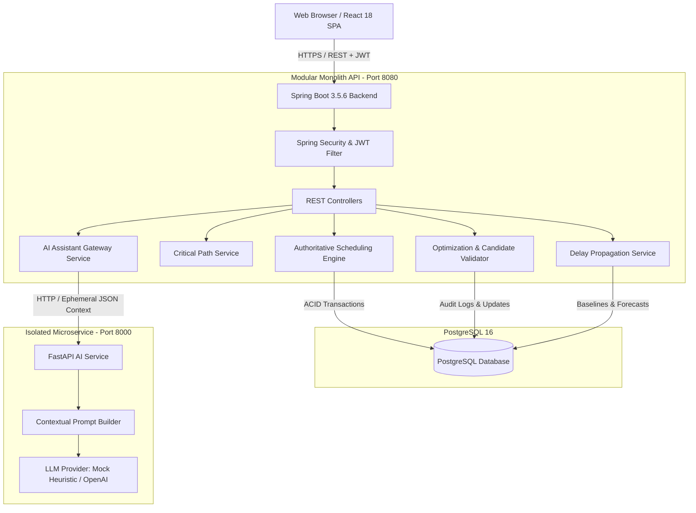

### 6.2 Scheduling & Critical Path Method (CPM) Workflow
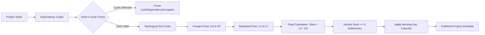

### 6.3 Downstream Delay Ripple Propagation
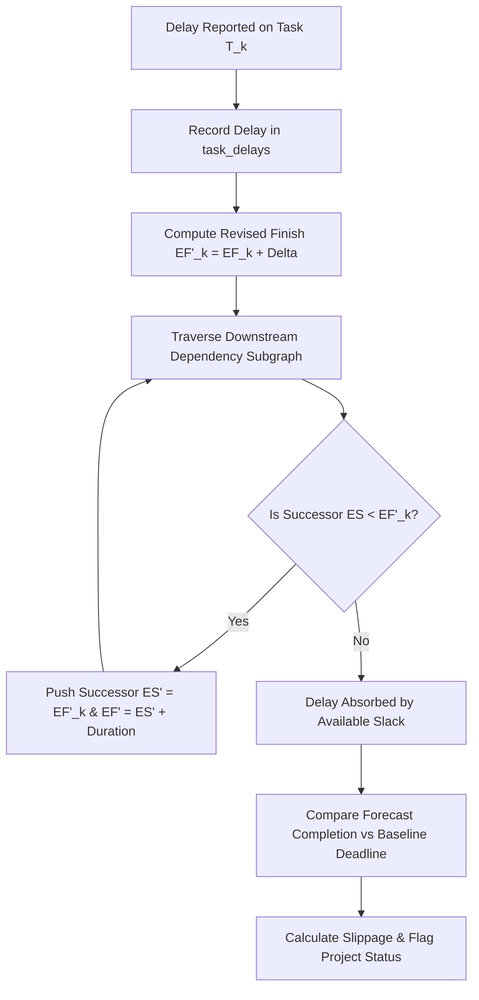

### 6.4 Multi-Objective Schedule Optimization Workflow
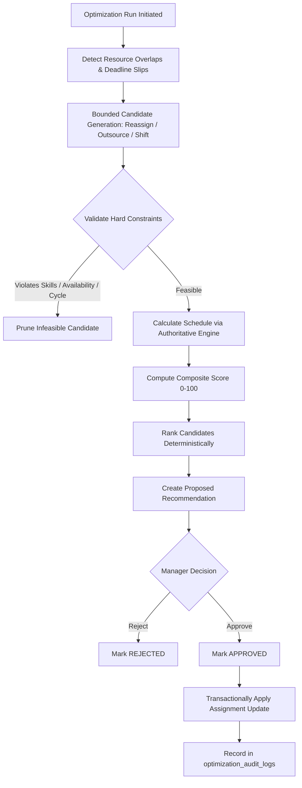

### 6.5 Relational Database Schema (ERD)
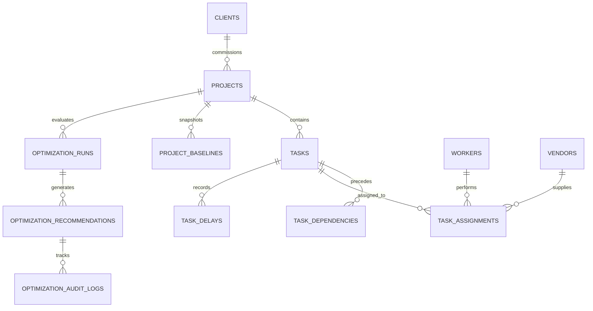

---

## 7. Guided 15-Step Product Demonstration

Follow this sequence to reproduce the complete product capabilities using real backend business logic:

1. **Sign In**: Navigate to `http://localhost:5173` and log in with username `admin` and password `admin`.
2. **Review Dashboard Operations**: Observe real-time metrics: Total Projects (2), Projects at Risk (2), Resource Conflicts (1), and active Team Workload distributions.
3. **Inspect Existing Projects**: Click **Schedule** and select **E-Commerce Website Launch** from the project selector.
4. **Review Dependencies & Gantt Chart**: Under the **Gantt Chart** tab, observe task timelines, milestones, and working-day spacing.
5. **Inspect Critical Path (CPM)**: Switch to the **Critical Path** tab. Review the 6-task bottleneck sequence (`Requirements → UI Design → Frontend Development → Integration → Testing → Deployment`) where total float is 0.
6. **Inspect Detected Resource Conflict**: Switch to the **Resource Overlaps** tab. Notice `Rahul Kumar` is flagged as double-booked on October 20–22 between `Backend Development` (Project 1) and `API Integration` (Project 2).
7. **Review Conflict Details**: Inspect the exact date overlap and conflicting task cards.
8. **Record a Supplier Delay**: Navigate to the **Delay Analysis** tab. Review how recorded vendor delays push downstream milestones while preserving historical baselines.
9. **Recalculate Schedule**: Click **Recalculate Schedule** and confirm that dates update strictly through the authoritative Spring Boot engine.
10. **Compare Baseline vs Forecast**: Inspect the variance badge showing delivery forecast vs approved deadline.
11. **Run Schedule Optimization**: Switch to the **Schedule Optimization** tab. Click **Run Schedule Optimization** with the `Balanced` objective.
12. **Inspect Ranked Recommendations**: Review the #1 candidate: Reassigning `Backend Development` to `Vikram Mehta` (Score: 89.5, 0 remaining conflicts, full skill match).
13. **Consult Grounded AI Assistant**: Switch to the **AI Assistant** tab. Ask *"What is causing the delay on E-Commerce Website Launch and how can we resolve the resource conflict?"*. Review the grounded explanation with source citations.
14. **Enact Authorized Recommendation**: In the Optimization tab, click **Approve** on Recommendation #1, then click **Apply Approved Changes**.
15. **Verify Resolved Conflict & Audit Log**: Switch back to **Resource Overlaps** and verify active conflicts have dropped to **0**. Scroll down to **Optimization Audit Log** to review the immutable record with timestamps and user credentials.

---

## 8. Deterministic Demo Environment & Reset Procedure

The system comes pre-seeded with a realistic fictional organization (Acme Corp, TechCorp Solutions) with parallel tasks, dependencies, cross-project worker assignments, and an active resource conflict for Rahul Kumar.

### How to Reset the Demo Environment
To return the local database to the canonical pre-optimization demonstration baseline at any time, execute:

```bash
# Using curl (Windows / Linux / macOS)
curl -X POST http://localhost:8080/api/demo/reset -H "Authorization: Bearer <your-admin-jwt>"

# Or via Node.js
node -e "fetch('http://localhost:8080/api/auth/login', {method:'POST', headers:{'Content-Type':'application/json'}, body:JSON.stringify({username:'admin', password:'admin'})}).then(r=>r.json()).then(a=>fetch('http://localhost:8080/api/demo/reset', {method:'POST', headers:{'Authorization':'Bearer '+a.token}})).then(r=>r.json()).then(console.log)"
```

The reset API restores the original double-booking on Rahul Kumar, resets recommendation states, and clears stale audit entries in a single transaction without needing to restart the database.

---

## 9. Installation & Local Setup

### Prerequisites
- **Java 21 JDK** (or use the pre-packaged portable JDK in `jdk21/`)
- **Node.js $\ge 18$**
- **Python $\ge 3.10$** (for AI service)
- **Maven $\ge 3.8$** (or use the pre-packaged binary in `apache-maven-3.9.6/`)

### Option A: Local Native Startup (Fastest for Development)

#### 1. Backend Service (Port 8080)
```powershell
# In project root:
$env:JAVA_HOME = "$pwd\jdk21\jdk-21.0.2+13"
$env:PATH = "$env:JAVA_HOME\bin;$env:PATH"
.\apache-maven-3.9.6\bin\mvn.cmd spring-boot:run -f backend/pom.xml
```
*Backend runs on `http://localhost:8080` with embedded Flyway migrations and in-memory H2 database (`jdbc:h2:mem:prs_db`).*

#### 2. Python AI Service (Port 8000)
```powershell
$env:PYTHONPATH = "$pwd\ai-service"
python -m uvicorn app.main:app --app-dir ai-service --host 0.0.0.0 --port 8000
```
*AI service runs on `http://localhost:8000` in zero-dependency heuristic fallback mode.*

#### 3. Frontend Web Client (Port 5173)
```powershell
cd frontend
node ./node_modules/vite/bin/vite.js --host
```
*Frontend opens at `http://localhost:5173`.*

### Option B: Docker Compose Multi-Container Stack
```bash
docker compose up -d --build
```

---

## 10. Default User Credentials & Workspaces

### Fictional Seed Workspaces
- **Acme Global Solutions** (Workspace Code: `ACM`)
- **Stark Industries** (Workspace Code: `STK`)

| Role | Username / Work Email | Employee ID | Password | Workspace | Default Capabilities |
|:---|:---|:---|:---|:---|:---|
| **Organization Owner / Admin** | `admin` (`admin@acme.com`) | `ACM-EMP-0001` | `admin` | `ACM` | Full organization settings, member provisioning, schedule optimization, demo reset |
| **Project Manager** | `manager` (`manager@acme.com`) | `ACM-EMP-0002` | `admin` | `ACM` | Project management, task scheduling, CPM analysis, member invitation |
| **Team Worker** | `worker` (`worker@acme.com`) | `ACM-EMP-0003` | `admin` | `ACM` | Assignment views, task progress updates |
| **Client Representative** | `client` (`client@acme.com`) | `ACM-EMP-0004` | `admin` | `ACM` | Client portal, deliverable review & approval |
| **Vendor Representative** | `vendor` (`vendor@acme.com`) | `ACM-EMP-0005` | `admin` | `ACM` | Vendor commitments, purchase order deliveries |
| **Secondary Tenant Owner** | `admin` (`admin@stark.com`) | `STK-EMP-0001` | `admin` | `STK` | Isolated secondary tenant administration, multi-tenancy verification |

*Note: Sign-in supports username, work email, or employee ID. In development mode (`DEV`), quick-fill shortcuts are provided for all 6 verified seed accounts. In production builds, development credentials and test controls are eliminated.*

### Password Policy & Recovery Architecture
- **Standardized Password Baseline**: Minimum 12 characters, maximum 128 characters. Prohibits common passwords (e.g. `password123456`, `qwertyuiop123`) and passwords containing the username. Enforced uniformly across Organization Workspace Setup, Employee Account Activation, Password Reset, and Authenticated Password Change.
- **End-to-End Recovery Flow**: Request reset $\to$ receive link $\to$ open dedicated `/reset-password?token=...` with token in URL $\to$ auto-verify token $\to$ set & confirm password $\to$ sign in.
- **Token Security**: Cryptographically secure 64-hex tokens generated via `SecureRandom`; stored in the database exclusively as `SHA-256` hashes; 1-hour expiration; atomically invalidated on single use.
- **Local Development Without SMTP**: When email delivery is not configured, development mode returns a controlled local direct-navigation reset link button on the UI, enabling testing without manual token copy-pasting.

---

## 11. Testing Instructions

### Backend Automated Test Suite (135 Tests)
```powershell
$env:JAVA_HOME = "$pwd\jdk21\jdk-21.0.2+13"
$env:PATH = "$env:JAVA_HOME\bin;$env:PATH"
.\apache-maven-3.9.6\bin\mvn.cmd test -f backend/pom.xml
```
- `Phase19AuthenticationCorrectionsTest` (20 tests) — Global case-insensitive username uniqueness, PostgreSQL/H2 migration, unified 12-character password policy, confirm password verification, password strength, end-to-end tokenized recovery (`/reset-password?token=...`), SHA-256 token hashing, atomic single-use invalidation, and development/production separation.
- `Phase18OrganizationAuthIntegrationTest` (8 tests) — Multi-identity login (email, employee ID), organization onboarding, employee invitation & activation, concurrency ID generation, password reset, and role security guards.
- `Phase16ReleaseCandidateTest` (5 tests) — End-to-end full project lifecycle regression.
- `Phase15ExternalIntegrationsTest` (9 tests) — Calendar sync, SSRF webhooks, scoped API keys.
- `Phase14DeliverablesApprovalIntegrationTest` (7 tests) — Deliverable lifecycle, gates, anti-self-approval.
- `Phase13CostManagementIntegrationTest` (5 tests) — Budgets, quotations, PO lifecycle, cost variance.
- `Phase12MultiTenantIntegrationTest` (9 tests) — Tenant filtering, workspace switching, isolation.
- `Phase11PortfolioAnalyticsIntegrationTest` (8 tests) — Portfolio KPIs, zero-denominator safeguards.
- `Phase10WorkflowAutomationIntegrationTest` (8 tests) — Notifications, CSV export/import, iCal feed.
- `Phase9HistoricalAnalyticsIntegrationTest` (5 tests) — Outcome recording, variance, ML gating.
- `Phase8AlgorithmValidationTest` (7 tests) — Cases A–G mathematical proofs.
- `Phase6ProductionReadinessIntegrationTest` (5 tests) — Security, concurrency, sanitized error handling, recalculation.
- `Phase5ApiIntegrationTest` (5 tests) — AI chat, history, hypothetical scenario simulation.
- `Phase4ApiIntegrationTest` (5 tests) — Optimization runs, alternatives, approval governance.
- `Phase3ApiIntegrationTest` (5 tests) — Critical Path Method, Gantt, delay propagation.
- `ApiIntegrationTests` (7 tests) — JWT authentication, CRUD operations.
- `CriticalPathServiceTest` (6 tests) — Forward/backward passes, float math.
- `DelayPropagationServiceTest` (3 tests) — Downstream ripple propagation and baseline freeze.
- `CandidateValidatorTest` (4 tests) — Skill checking, cycle prevention, composite scoring.
- `SchedulingEngineTest` (6 tests) — Topological sort, calendar dates.

### AI Service Automated Test Suite (12 Tests)
```powershell
$env:PYTHONPATH = "$pwd\ai-service"
python -m pytest ai-service/tests
```
- 12/12 tests passing (health endpoints, prompt generation, grounding validation, scenario schema verification, ML pipeline).

### Frontend Production Build
```powershell
cd frontend
node ./node_modules/vite/bin/vite.js build
```
- Transpiles 1557 modules with 0 TypeScript errors into production `/dist` bundle.

---

## 12. Production Deployment Readiness

For complete deployment specifications, environment configuration, database isolation, and cloud hosting guides (Render, Railway, AWS ECS), see [`docs/deployment_guide.md`](docs/deployment_guide.md).

---

## 13. Security & Governance Considerations

- **Stateless Authentication**: Signed HMAC-SHA256 JWT bearer tokens with 24-hour expiration.
- **Role-Based Access Control**: Declarative `@PreAuthorize` guards restricting managerial and administrative endpoints.
- **Zero Stack Trace Leaks**: Custom global exception handlers intercept uncaught exceptions and format standardized, sanitized REST responses.
- **SQL Injection Defense**: 100% parameterized queries via Spring Data JPA and Hibernate ORM.
- **Read-Only AI Boundaries**: The AI service possesses zero database credentials and cannot execute schedule mutations; context is passed strictly as ephemeral, read-only JSON.
- **Prompt Injection Defense**: Input filters strip delimiter hijacking patterns before prompt assembly.

---

## 14. Known Limitations

- **Heuristic Optimization Horizon**: The optimizer uses bounded heuristic search rather than an exact integer linear programming (ILP) solver. For projects with $>500$ concurrent overlapping tasks, solutions are locally optimal rather than globally provable.
- **Single-Timezone Calendar**: The working-day calculator currently assumes a unified corporate calendar (Monday–Friday work week) and does not yet support per-worker regional holiday calendars.

---

## 15. Future Improvements

1. **Multi-Project Cross-Dependency Sync**: Synchronize milestone dependencies between independent project DAGs.
2. **Monte Carlo Schedule Risk Simulation**: ProbabilisticPERT duration modeling to project confidence intervals on delivery dates.
3. **Regional Shift Calendars**: Per-worker custom working-hour profiles and international holiday support.

---

## 16. Technical Documentation Suite

- [`docs/IMPLEMENTATION_STATUS.md`](docs/IMPLEMENTATION_STATUS.md): Complete component-by-component implementation matrix and verification status.
- [`docs/TESTING.md`](docs/TESTING.md): Verification suite guide and proofs for mathematical cases A through G.
- [`docs/ARCHITECTURE.md`](docs/ARCHITECTURE.md): System topology, CPM graph math, heuristic scoring functions, and security boundaries.
- [`docs/KNOWN_LIMITATIONS.md`](docs/KNOWN_LIMITATIONS.md): Transparent engineering boundaries, RCPSP trade-offs, and calendar constraints.
- [`docs/interview_preparation_guide.md`](docs/interview_preparation_guide.md): In-depth software engineering interview guide covering architectural trade-offs, CPM mathematics, heuristic scoring formulas, and AI safety guardrails.
- [`docs/deployment_guide.md`](docs/deployment_guide.md): Production containerization, environment variables, database backup procedures, and cloud hosting architecture.
- [`CHANGELOG.md`](CHANGELOG.md): Detailed version history documenting progression through Phases 1–8.

---

## 17. Resume & Portfolio Entry

### One-Line Project Summary
> *A full-stack project operations and scheduling system built with Spring Boot, React, and PostgreSQL, featuring deterministic Critical Path Method (CPM) analytics, topological delay propagation, heuristic multi-objective schedule optimization, and a secure AI intelligence layer.*

### Resume Bullets
- **Architected Full-Stack Operations Platform**: Engineered an enterprise scheduling system using Java 21, Spring Boot 3.5.6, PostgreSQL, and React 18 / TypeScript, coordinating multi-project dependencies, resource allocations, and contractual deadlines.
- **Implemented Graph & CPM Engines**: Designed deterministic topological sorting (Kahn's algorithm) and Critical Path Method (CPM) algorithms calculating early/late dates, total float, and bottleneck tasks across weekend-skipping working-day calendars.
- **Engineered Multi-Objective Optimizer**: Built a heuristic optimization engine that detects resource overlaps and generates, ranks, and transactionally applies feasible reassignment and rescheduling alternatives with full audit logging.
- **Isolated AI Intelligence Microservice**: Developed a decoupled FastAPI Python AI service implementing grounded contextual Q&A and in-memory hypothetical what-if simulations with strict read-only database isolation.
- **Automated Verification & CI**: Established a 100% passing automated test suite (44 Spring Boot integration/unit tests, 6 Pytest AI tests) and automated CI pipeline verifying zero stack trace leaks, concurrency safety, and production builds.

### GitHub Project Description
> *Full-stack project scheduling & resource allocation platform (Spring Boot 3, React 18, TypeScript, PostgreSQL, FastAPI). Features Kahn's DAG cycle detection, Critical Path Method (CPM), downstream delay ripple propagation, bounded heuristic schedule optimization, and grounded AI assistant.*

---

## 18. License

This project is licensed under the [MIT License](LICENSE).
