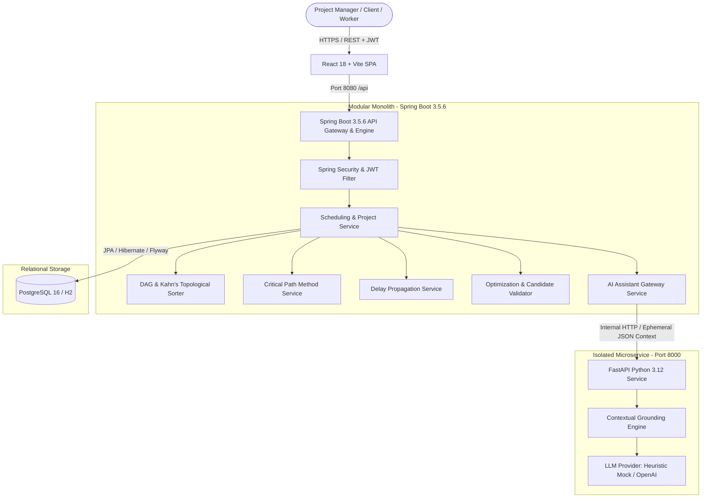
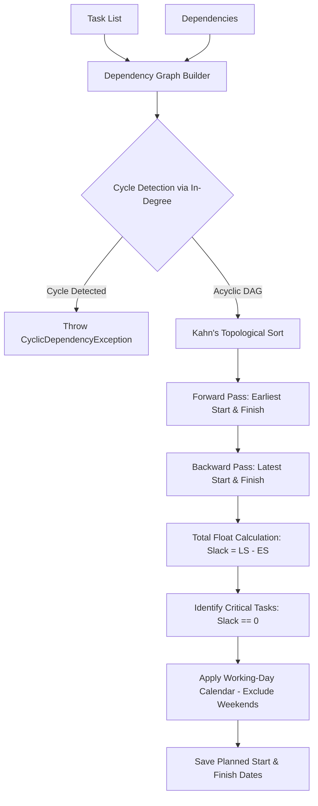
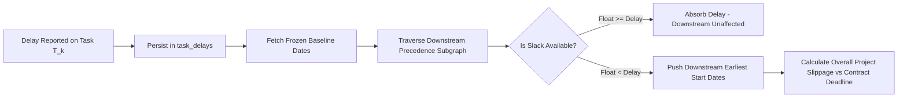

# System Architecture & Technical Design
## Project Resource Allocation & Scheduling System (PRS)

This document provides architectural blueprints, data flow diagrams, and design rationales for the **Project Resource Allocation & Scheduling System (PRS)**.

---

## 1. High-Level Architectural Topology

PRS adopts a **modular monolith** backend coupled with an **isolated AI microservice** and a responsive **React Single Page Application (SPA)**:



### Architectural Rationales
1. **Why Spring Boot (Java 21) for Core Scheduling?**
   Scheduling calculations, CPM graph traversals, and multi-objective heuristics require strict type safety, predictable memory footprints, deterministic execution, and ACID transaction boundaries (`@Transactional`). Java 21 provides enterprise stability, high throughput, and robust concurrency primitives.
2. **Why Decouple the AI Service into FastAPI Python?**
   Python is the de-facto ecosystem for LLM orchestration and data science. Isolating the AI assistant into an independent microservice ensures:
   - Zero risk of Python library overhead or memory bloat affecting core transaction processing.
   - Strict read-only boundary: the Python service has **zero** direct database credentials and receives context purely as ephemeral JSON payloads.
   - Graceful degradation: if the AI service or external LLM is offline, core scheduling and project management remain 100% operational.

---

## 2. Core Scheduling & Graph Subsystem



### Topological Sorting & Precedence Math
1. **Graph Definition**: $G = (V, E)$ where vertices $V$ are tasks, and edges $E = \{(u, v)\}$ represent dependencies requiring task $u$ to finish before task $v$ starts.
2. **Kahn's In-Degree Sorter**:
   - Compute in-degree $d_{in}(v)$ for all $v \in V$.
   - Maintain a queue $Q$ of all vertices with $d_{in}(v) = 0$.
   - Dequeue $u$, append to sorted sequence, and decrement $d_{in}(w)$ for all $(u, w) \in E$.
   - If $|\text{sorted sequence}| < |V|$, cycle detected; throw `IllegalStateException`.

---

## 3. Delay Propagation Subsystem



---

## 4. Bounded Multi-Objective Schedule Optimizer

The optimization engine generates, scores, and ranks alternative resource allocations and schedules to resolve overallocation and deadline breaches without silent mutations.

### Optimization Workflow
```mermaid
sequenceDiagram
    autonumber
    actor PM as Project Manager
    participant Opt as ScheduleOptimizationService
    participant Gen as CandidateGenerator
    participant Val as CandidateValidator
    participant Eval as CandidateEvaluator
    participant DB as PostgreSQL Database

    PM->>Opt: POST /api/projects/{id}/optimization/runs
    Opt->>DB: Load tasks, dependencies, active assignments
    Opt->>Gen: Generate bounded candidate alternatives
    Gen-->>Opt: List of Candidates (reassign, outsource, shift)
    loop For each candidate
        Opt->>Val: Validate hard constraints (skills, availability, cycles)
        Val-->>Opt: VALID or REJECTED
        opt If VALID
            Opt->>Eval: Calculate composite score (0 - 100)
            Eval-->>Opt: Objective score & remaining conflicts
        end
    end
    Opt->>Opt: Deterministic ranking (deadline met > score > conflicts > disruption)
    Opt->>DB: Persist OptimizationRun & ScheduleAlternatives
    Opt-->>PM: Return ranked proposals (Top candidate = PROPOSED)
    PM->>Opt: POST /api/recommendations/{id}/approve
    Opt->>DB: Transition status to APPROVED
    PM->>Opt: POST /api/recommendations/{id}/apply
    Opt->>DB: Transactionally update assignments, recalculate schedule, record audit log
    Opt-->>PM: Confirmed applied schedule (Conflicts = 0)
```

### Multi-Objective Scoring Formula
Normalized composite utility score ($0 \le \text{Score} \le 100$):
$$\text{Score} = 0.40 \cdot S_{\text{deadline}} + 0.25 \cdot S_{\text{time}} + 0.15 \cdot S_{\text{conflicts}} + 0.10 \cdot S_{\text{disruption}} + 0.10 \cdot S_{\text{balance}}$$

- **$S_{\text{deadline}}$ (40%)**: 100 pts if forecast $\le$ contractual deadline; minus 15 pts per overdue working day.
- **$S_{\text{time}}$ (25%)**: $70 + (\text{working days saved} \times 10)$, clamped to $[0, 100]$.
- **$S_{\text{conflicts}}$ (15%)**: 100 pts if 0 remaining conflicts; minus 35 pts per remaining overlap.
- **$S_{\text{disruption}}$ (10%)**: $100 - (\text{modifications count} \times 15)$, rewarding minimal schedule churn.
- **$S_{\text{balance}}$ (10%)**: Penalizes resource overallocation across the team.

---

## 5. Security Architecture & Threat Model

1. **Authentication**: Stateless HMAC-SHA256 JWT tokens verified on every request via `JwtAuthenticationFilter`.
2. **Authorization**: Spring Security role hierarchy (`ADMIN`, `PROJECT_MANAGER`, `WORKER`, `CLIENT`) with method-level `@PreAuthorize` security.
3. **Data Sanitization**: Global exception handler (`CustomGlobalExceptionHandler`) intercepts all unhandled errors, preventing stack trace leaks.
4. **SQL Injection Defense**: 100% parameterized queries via Spring Data JPA and Hibernate criteria builders.
5. **AI Ephemeral Context Boundary**:
   - Zero direct database connections for Python FastAPI.
   - All state serialized through authorized Spring Boot services.
   - Read-only scope: AI cannot approve recommendations, reassign workers, or mutate project records.
